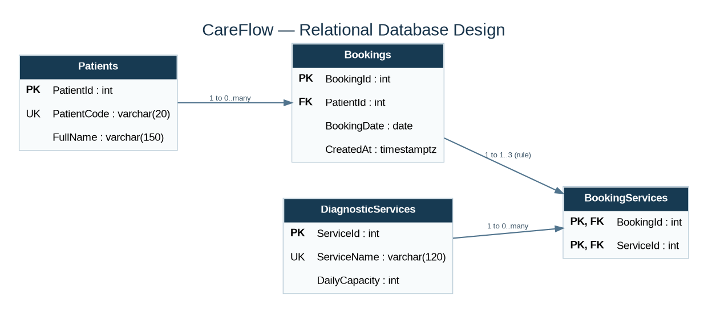
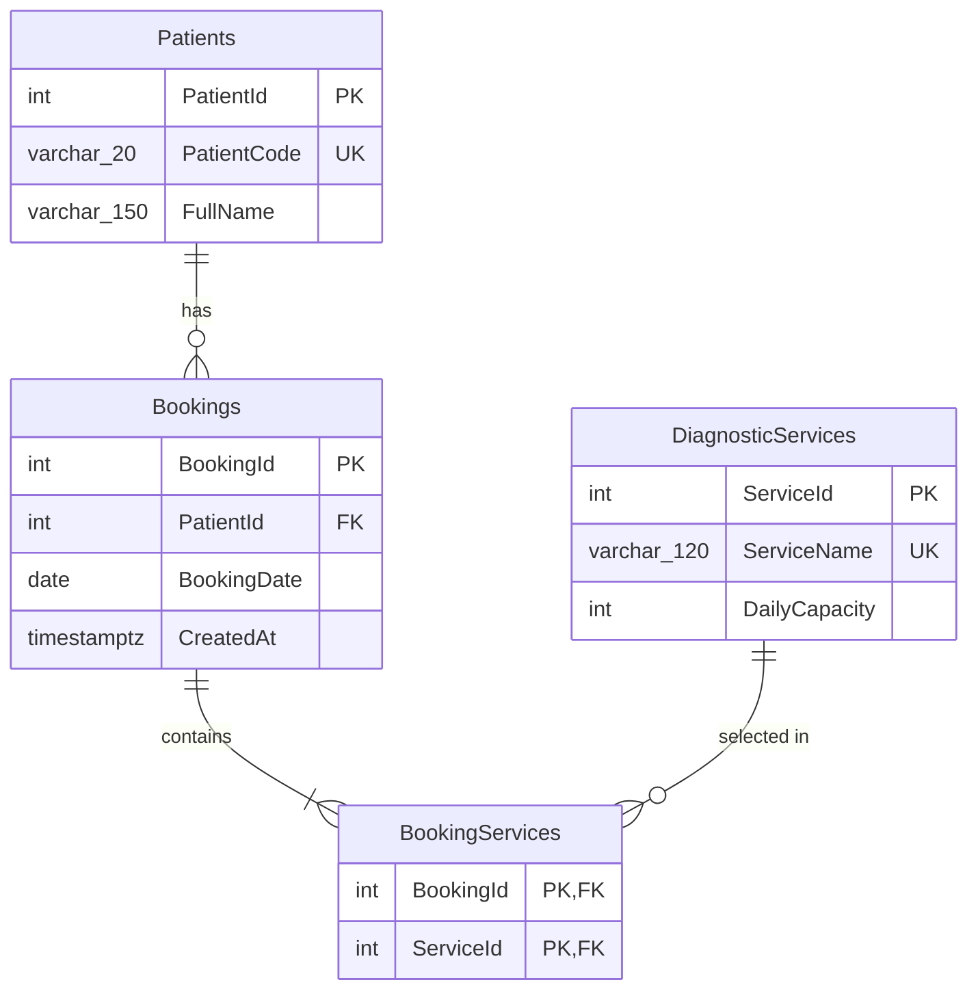

# CareFlow — Relational Database Design

The diagram is based on the Entity Framework Core model and initial migration (`20261116152157_InitialCreate`). All four business tables are stored in PostgreSQL; `__EFMigrationsHistory` is framework migration metadata and is excluded from the business ERD.

## Tables and constraints

| Table | Primary key | Foreign keys | Other constraints and indexes |
|---|---|---|---|
| `Patients` | `PatientId` | — | `PatientCode` unique, required, max 20; `FullName` required, max 150 |
| `DiagnosticServices` | `ServiceId` | — | `ServiceName` unique, required, max 120; `DailyCapacity > 0` |
| `Bookings` | `BookingId` | `PatientId → Patients.PatientId` (restrict delete) | `BookingDate` required and indexed; `CreatedAt` defaults to `now()` in UTC-aware PostgreSQL timestamp; `PatientId` indexed |
| `BookingServices` | (`BookingId`, `ServiceId`) | `BookingId → Bookings.BookingId`; `ServiceId → DiagnosticServices.ServiceId` (both restrict delete) | `ServiceId` indexed; composite PK prohibits duplicate service rows within a booking |

**Cardinalities:** One patient can have many bookings; each booking belongs to exactly one patient. A booking contains 1–3 distinct services as an **application-level rule** (the physical junction table permits multiple rows and does not independently enforce the maximum of three). A diagnostic service can belong to many bookings.

**Availability:** No separate remaining-capacity column is stored. The application counts confirmed booking-service associations for the selected `BookingDate` and subtracts that count from `DiagnosticServices.DailyCapacity`. The booking service enforces capacity inside a transaction with ordered PostgreSQL row locks to prevent concurrent overbooking.
